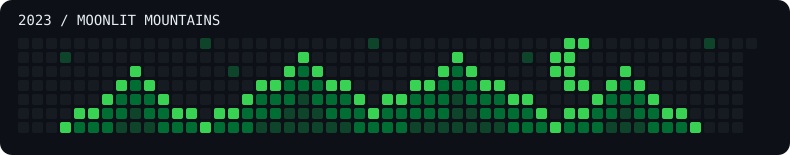

# 2023 contribution art: Moonlit Mountains

Intentional pixel art for [davlabs-us’s 2023 contribution graph](https://github.com/davlabs-us?tab=overview&from=2023-01-01&to=2023-12-31).

These commits are decorative, backdated art pixels, not a record of software work performed in 2023. Author and committer timestamps are set to noon UTC on each painted day. The art lives on the default `main` branch in this standalone repository. Existing contributions are preserved. The 2026 design uses dates through October 31, 2026 only.

`art.json` records the exact added commits and the expected calendar including pre-existing contributions. `generate.py` recreates the same artwork in a fresh directory. Do not push another copy to the same account because its contributions would add to this one. The SVG is a design preview; GitHub controls the actual color scale.

To remove this artwork, delete this dedicated repository on GitHub and allow time for GitHub to recalculate the graph.
